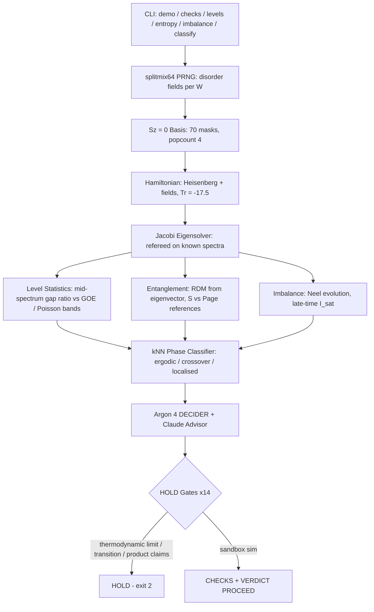
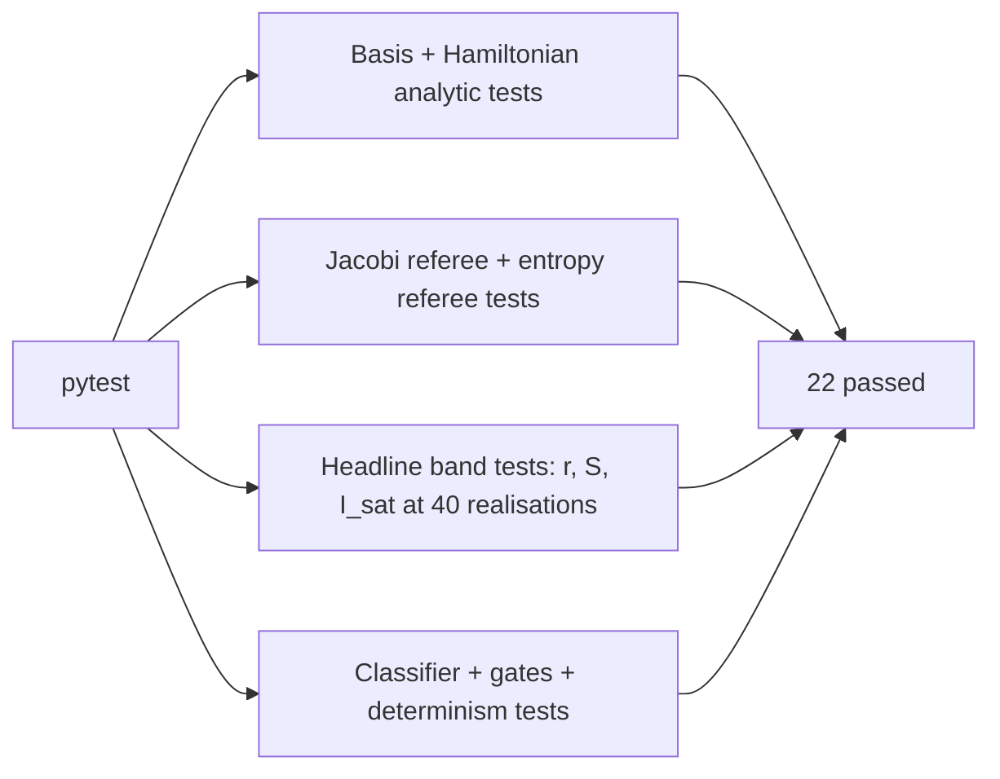
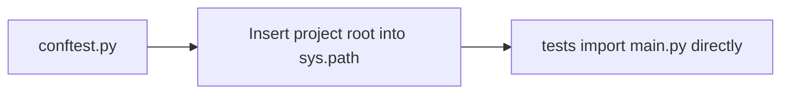
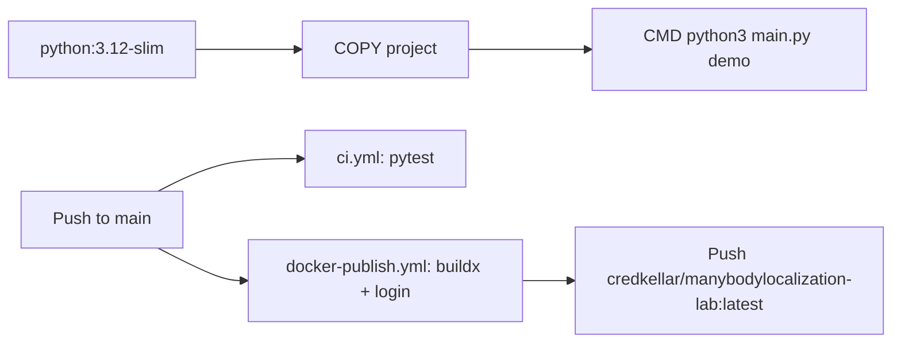

# ManyBodyLocalization-Lab 🧲⚛️

**Disordered Heisenberg Chain Lab — Level Statistics, Entanglement & Imbalance in the Sz = 0 Sector** — by Darion Kellar

ManyBodyLocalization-Lab is an **educational many-body localisation lab** in ONE pure-Python file. It builds the disordered Heisenberg chain at **N = 8** — `H = Σᵢ J Sᵢ·Sᵢ₊₁ + Σᵢ hᵢ S^zᵢ` (open chain, J = 1, fields uniform in [−W, W]) — diagonalises it **exactly in the Sz = 0 sector** (dimension C(8,4) = **70**, built explicitly mask by mask) with a from-scratch Jacobi eigensolver, and computes **three thermalisation signatures from the same eigendecomposition**, grading each against its statistical anchor with honest tolerance **bands**:

- the **level-statistics view**: the mid-spectrum adjacent-gap ratio ⟨r⟩ over 40 disorder realisations — at W = 1, **⟨r⟩ = 0.492990**, inside the GOE band [0.4759, 0.5959] around the Wigner–Dyson anchor 0.5359 (near the band's lower edge — finite-size, stated plainly); at W = 12, **⟨r⟩ = 0.393632**, inside the Poisson band [0.3263, 0.4463] around 0.3863; the separation is **0.099358** against a stated margin of 0.07;
- the **entanglement view**: the half-chain von Neumann entropy of a mid-spectrum eigenstate, from its reduced density matrix — **S(W = 1) = 1.671124** vs **S(W = 12) = 0.080376**, a margin of **1.590748** against a stated 0.8, with two Page-style references computed and fenced as approximate (unrestricted formula 2.272589; in-sector random-state estimate 2.141758);
- the **dynamics view**: a Néel state time-evolved with the eigen-decomposition — I(0) = 1 exactly by construction, and the late-time average (t = 10…20) gives **I_sat(W = 12) = 0.807514** (the pattern largely survives) vs **I_sat(W = 1) = 0.156726** — near zero only within the stated finite-size tolerance 0.20, a residual of the 8-site chain, **not** zero, and not claimed as zero.

Honest scope, stated up front: this is an **N = 8 finite-size toy**. The bands are statistical statements about 40 realisations of a 70-dimensional sector. **The MBL transition in the thermodynamic limit is NOT located, estimated, or claimed anywhere** — every verdict uses finite-size crossover language only, and thermodynamic-limit / transition-location claims are permanent HOLD gates (14 total). 🔒

[](https://github.com/kimanicollier44-cmyk/ManyBodyLocalization-Lab/actions/workflows/ci.yml)
[](https://github.com/kimanicollier44-cmyk/ManyBodyLocalization-Lab/actions/workflows/docker-publish.yml)

> ℹ️ These are the **live** workflow badges for this repo. They activate as soon as the `ci.yml` and `docker-publish.yml` files from the paste pack are pasted into `.github/workflows/` — until then they have nothing to report yet.

## 🧰 Tech Stack Badges & Full Architecture Tech Stack

### 💻 Core Programming Languages & Core Systems


- 🐍 Python 3.12, pure standard library (`math`, `cmath`, `hashlib`, `json`, `sys`) — zero dependencies, zero network, deterministic (double-run byte-identical)
- 🧲 Many-body core from scratch: the Sz = 0 basis built explicitly (every 8-bit mask of popcount 4), the Heisenberg Hamiltonian assembled entry by entry (diagonal ±1/4 per bond plus field terms; off-diagonal 1/2 only between masks differing by one adjacent spin exchange — both facts asserted in CHECKS), and a cyclic **Jacobi eigensolver** for real symmetric matrices that is refereed against known spectra before it is trusted with the Hamiltonian, then refereed again on the Hamiltonian itself (orthonormality, residuals, eigenvalue sum = trace)
- 🎲 Disorder from the in-file **splitmix64** PRNG only — one stream per W, seeded `2026 + round(1000·W)`, fields drawn realisation by realisation, site by site; no other randomness exists in the lab
- 📊 Level statistics: adjacent-gap ratios over the central half of the spectrum (35 eigenvalues → 33 ratios per realisation), graded against the GOE (0.5359) and Poisson (2 ln 2 − 1 = 0.3863) anchors with ±0.06 bands whose edges are printed, never hidden
- 🔗 Entanglement core: eigenvector reshaped to a 16×16 left/right matrix, reduced density matrix `ρ_L = M Mᵀ`, entropy from its Jacobi eigenvalues; refereed on a product state (S = 0) and a two-state superposition (S = ln 2) before any eigenstate is measured
- 🧠 TinyML kNN phase classifier (from scratch, stdlib, distance-weighted, features normalised by stated scales): ergodic / crossover / localised from (⟨r⟩, S_half, I_sat), labels from the lab's own policy
- 🪑 Council seats: Gemini Argon 4 DECIDER (names-only, tighten-only) + Muse advisor (never overrides HOLD) + Google Flow plan-only (rendered = False, live = 0)

### ⛓️ Web3 & Infrastructure

- 🚫 **Not applicable — honestly.** No blockchain, no Web3, no tokens: the "infrastructure" in this lab is one offline file holding a 70-state sector and a Jacobi solver. Quantum-memory product and hardware-design claims are permanent HOLD gates, not features. No fake badges here.

### ⚙️ Platform Support & Hardware Architecture


- 🖥️ Pure Python — runs anywhere Python 3.12+ runs (Linux, macOS, Windows), plus the `python:3.12-slim` Docker image
- 🔒 No hardware is controlled, ever: real qubits, chains, and laboratory hardware are permanent HOLD gates (see the gate table below)

### ⚡ Low-Level Infrastructure & Performance

- 🚫 **No low-level code — honestly.** No C, no C++, no GPU, no compiled extensions, no numpy: this is one interpreted Python file on purpose, so every matrix entry can be read, checked, and diffed. Performance here means honest algorithms — a Jacobi eigensolver instead of a library call, one eigendecomposition per realisation feeding all three signatures (results cached per (W, n_real) inside a run), exact diagonalisation instead of Monte Carlo — all deterministic and byte-identical between runs. The full 40-realisation headline ensemble takes under a minute.

### 🛠️ DevOps & Build Tools


- 🐳 Docker (`python:3.12-slim`), GitHub Actions CI + Docker Publish (delivered in the paste pack)
- 🎯 Target image: `credkellar/manybodylocalization-lab:latest`
- 🧪 Tests: `pytest` (22 tests) + the built-in CHECKS suite (54 checks) in `main.py`

### ☁️ Cloud Providers

- 🚫 **None — honestly.** No cloud provider is used or needed: the lab runs fully offline on your own machine or in a local Docker container. Docker Hub appears only as the registry the publish workflow pushes the image to.

## What this does?

1. 🧲 **Sector + Hamiltonian, built in the open** — the Sz = 0 sector is enumerated explicitly (70 masks of popcount 4; the Néel mask `01010101` sits at sector index 20), and H is assembled with the stated conventions. Two receipts are asserted: H is symmetric, its only nonzero off-diagonals are 1/2 between adjacent-exchange partners, and **Tr H = −17.5 for ANY disorder fields** (field terms cancel — each site is up in exactly half the sector — and each of the 7 bonds contributes 0.25 × (30 equal − 40 opposite) = −2.5).
2. 🛠️ **Jacobi eigensolver, refereed first** — the from-scratch cyclic Jacobi solver must reproduce {−1, +1} for σ_x, {1, 3} for [[2,1],[1,2]], and {2−√2, 2, 2+√2} for a tridiagonal referee before touching H; on H itself its eigenvectors are checked for orthonormality, its residuals `|Hv − Ev|` are checked below 1e-8, and its eigenvalue sum must equal the analytic trace −17.5.
3. 📊 **Level statistics with bands, not fake precision** — mid-spectrum ⟨r⟩ over 40 realisations: **W = 1 → 0.492990** (std 0.058809), inside the GOE band [0.4759, 0.5959] but near its lower edge — the finite-size truth, printed as-is; **W = 12 → 0.393632** (std 0.056776), inside the Poisson band [0.3263, 0.4463]. The separation **0.099358** clears the stated margin 0.07. The bands are checks with printed edges, not decorations.
4. 🔗 **Entanglement from the eigenvector itself** — the mid-spectrum eigenvector is reshaped into a 16×16 left/right matrix and `ρ_L = M Mᵀ` is diagonalised: **S(W = 1) = 1.671124** (std 0.277153) vs **S(W = 12) = 0.080376** (std 0.132719) — volume-law-ish vs area-law-ish at this size, margin **1.590748** vs the stated 0.8. The entropy routine is refereed first: product state → 0, two-state superposition → ln 2, exactly.
5. 📖 **Page references, computed and fenced** — two approximate references are printed next to S, both labelled approximate: the unrestricted Page formula ln 16 − 1/2 = **2.272589**, and a deterministic in-sector estimate — the mean entropy of random unit vectors drawn inside the Sz = 0 sector itself — **2.141758**. The ergodic-side S = 1.671 sits *below* both, which is the honest finite-size / mid-spectrum picture at N = 8, not a failure to be hidden.
6. 🕐 **Imbalance dynamics from the eigen-decomposition** — the Néel state (I(0) = 1 exactly, asserted) is time-evolved as `ψ(t) = Σₖ V[:,k] ⟨k|ψ₀⟩ e^(−iEₖt)`; probabilities stay normalised to 1e-9 and |I(t)| ≤ 1 at every probed time. Averaged over t ∈ {10, 12, 14, 16, 18, 20} and 40 realisations: **I_sat(W = 1) = 0.156726** (std 0.131652) — inside the stated 0.20 finite-size tolerance around zero, with the residual named as a residual — and **I_sat(W = 12) = 0.807514** (std 0.135844): the imprinted pattern largely refuses to wash out. Margin **0.650788** vs the stated 0.4.
7. 🌊 **The crossover, swept** — the cover's curves are the lab's own sweep (10 realisations per point): ⟨r⟩ slides 0.5408 (W = 0.5) → 0.4094 (W = 12), S falls 1.920 → 0.055, and I_sat climbs 0.034 → 0.831 — a smooth finite-size crossover at N = 8, presented as exactly that and never as a located transition.
8. 🏷️ **Phase classifier** — a from-scratch distance-weighted kNN over the lab's own policy labels verdicts from (⟨r⟩, S, I_sat): W = 1 (0.492990, 1.671124, 0.156726) → **ergodic**, W = 2 (0.446653, 0.709698, 0.300353, 12 realisations) → **crossover**, W = 12 (0.393632, 0.080376, 0.807514) → **localised**; kNN == policy is asserted on every scenario and all 294 training-grid rows.
9. 🎲 **Determinism as a check** — all randomness is the in-file splitmix64 (seed stated per W); the full pipeline re-run at small size must reproduce ⟨r⟩, S, and I_sat bit-for-bit, and the demo run twice is byte-identical (sha256-verified).
10. 🪑 **Seats + checks** — Gemini Argon 4 DECIDER (sha256 trace, tighten-only), Muse advisor, Google Flow plan-only, 14 permanent HOLD gates — including a dedicated **thermodynamic-limit gate** and a **phase-transition-location gate** — and a built-in CHECKS suite (54 checks) that re-derives every headline number above.

## 🗺️ How it works — diagram per script

### `main.py` — the whole lab



### `tests/test_main.py` — verification



### `conftest.py` — test path setup



### `Dockerfile` + CI flow — container & publish



## Why is this cool?

1. 🎯 The three signatures **disagree with slogans and agree with each other**: one eigendecomposition says the spectrum goes Poisson, the eigenstates stop entangling, and the Néel pattern stops decaying — the MBL story told by three independent witnesses computed from the same matrix.
2. 📏 Bands are **printed with their edges**: ⟨r⟩(W = 1) = 0.492990 lands *inside* the GOE band but near its lower edge, and the README says so — a lab that grades itself honestly instead of rounding 0.493 up to "0.536 ✓".
3. 🧾 The Hamiltonian carries an **analytic receipt**: Tr H = −17.5 for *any* disorder draw, derived by counting (30 equal vs 40 opposite bond configurations), so a whole class of assembly bugs is caught by one number.
4. 🔗 Entanglement is **measured off the eigenvector**, not quoted: reshape, `M Mᵀ`, Jacobi eigenvalues, `−Tr ρ ln ρ` — and the routine first has to earn trust on S = 0 and S = ln 2 referee states.
5. 📖 The Page value is **computed for the sector, not copied for the Hilbert space**: random in-sector states average 2.141758, below the unrestricted formula's 2.272589 — and the ergodic eigenstates sit below both, which is the real finite-size story.
6. 🕐 I_sat(W = 1) = 0.157 is **reported as a residual, not a zero**: the lab states its tolerance (0.20) up front and names the leftover imbalance as the finite-size effect it is.
7. 🎲 One PRNG, stated seeds, **byte-identical demos**: the disorder stream for each W is seeded `2026 + round(1000·W)` and drawn in a stated order, so anyone can regenerate every field in the paper trail.
8. 🏷️ The classifier's features are **physical, not decorative**: gap ratio, entropy, imbalance — so its ergodic / crossover / localised verdicts can be argued with, number by number.
9. 🚧 The two most-abused claims in this field get **their own gates**: `thermodynamic_limit_claim` and `phase_transition_location_claim` are permanent HOLDs — the lab structurally cannot be quoted as locating the MBL transition.
10. 🛠️ The eigensolver is **home-made and refereed twice**: known spectra first, then orthonormality + residuals + trace on the Hamiltonian itself — a 70×70 diagonalisation a student can audit line by line, with no numpy anywhere.

## What problems this solves?

1. ❌ **Problem:** "MBL transition at Wc ≈ 3.7" gets quoted from thermodynamic-limit numerics as if a toy model could locate it. ✅ **Solution:** This lab never quotes a Wc: it reports a smooth N = 8 crossover, and transition-location and thermodynamic-limit claims are permanent HOLD gates.
2. ❌ **Problem:** Gap-ratio values are reported to four decimals from a handful of samples, as if they were constants of nature. ✅ **Solution:** 40 realisations, population std printed (0.058809 / 0.056776), and grading against ±0.06 **bands** around the anchors — with the W = 1 value's position near the band edge stated openly.
3. ❌ **Problem:** Entanglement claims cite the Page value for the full Hilbert space while working in a symmetry sector. ✅ **Solution:** Both references are computed — the unrestricted formula (2.272589) and the in-sector random-state estimate (2.141758) — and fenced as approximate.
4. ❌ **Problem:** "The imbalance decays to zero in the ergodic phase" — at N = 8 it visibly does not. ✅ **Solution:** The residual 0.156726 is printed, the tolerance (0.20) is stated before the number is graded, and the leftover is named a finite-size residual.
5. ❌ **Problem:** Hamiltonian assembly bugs (wrong bond sign, leaked Sz sectors) silently poison every downstream number. ✅ **Solution:** Symmetry, exchange-only off-diagonals, sector popcounts, and the analytic trace −17.5 are all asserted before any physics is read off.
6. ❌ **Problem:** Library eigensolvers make student code unauditable and platform-dependent. ✅ **Solution:** A from-scratch Jacobi solver, refereed on known spectra and on the Hamiltonian itself (orthonormality, residuals < 1e-8, eigenvalue sum = trace).
7. ❌ **Problem:** Disorder averages that can't be reproduced because the RNG was whatever the library felt like. ✅ **Solution:** One in-file splitmix64, one stated seed formula per W, one stated draw order — the demo is byte-identical between runs, sha256-verified.
8. ❌ **Problem:** Dynamics shown at one photogenic time instead of a stated late-time average. ✅ **Solution:** I_sat is defined up front as the average over t ∈ {10, 12, 14, 16, 18, 20} and over 40 realisations; I(0) = 1 is asserted exactly, and probability normalisation is checked mid-evolution.
9. ❌ **Problem:** Phase labels attached by vibes. ✅ **Solution:** A written policy over (⟨r⟩, S, I_sat), a kNN that must reproduce the policy on all 294 grid rows and every computed scenario, and crossover as a first-class verdict — not a failed ergodic/localised.
10. ❌ **Problem:** Toy localisation models quietly become quantum-memory product claims. ✅ **Solution:** 14 named HOLD gates (quantum memory products, hardware design, experimental validation, thermalisation guarantees…) return exit code 2, permanently.

## How to install this?

1. 📋 Clone or download this project folder.
2. 🐍 Make sure Python 3.12+ is installed: `python3 --version`
3. ▶️ Run the full demo + checks (no arguments needed):

```bash
python3 main.py
```

4. 🧪 Run the test suite:

```bash
pip install pytest
python3 -m pytest -q
```

5. 🎛️ Try the other commands:

```bash
python3 main.py checks    # 54 built-in checks
python3 main.py levels    # <r> at W = 1 / 12 vs GOE / Poisson bands (JSON)
python3 main.py entropy   # S at W = 1 / 12 + Page references (JSON)
python3 main.py imbalance # I_sat at W = 1 / 12, I(0) = 1 exact (JSON)
python3 main.py sweep     # W = 1..12 crossover sweep, 8 realisations (JSON)
python3 main.py classify  # kNN phase classifier report
python3 main.py brains    # Argon 4 + Muse + Flow seats
python3 main.py holds     # list all 14 HOLD gates
python3 main.py hold-demo # exits 2 - gated actions stay HOLD
```

6. 🐳 Or run it in Docker:

```bash
docker build -t credkellar/manybodylocalization-lab:latest .
docker run --rm credkellar/manybodylocalization-lab:latest
```

## Requirements

- 🐍 Python 3.12 or newer
- 📦 Dependencies: **none** (standard library only)
- 🌐 Network: **none** — fully offline
- 🧪 For tests only: `pytest`
- 🐳 Optional: Docker

## FULL project structure tree

```text
manybodylocalization-lab/
├── main.py                  # the whole lab: splitmix64 PRNG, Sz = 0 basis, Heisenberg Hamiltonian, Jacobi eigensolver, gap ratios, entanglement, imbalance dynamics, classifier, seats, HOLD gates
├── conftest.py              # puts the project root on sys.path for tests
├── tests/
│   └── test_main.py         # 22 pytest tests: basis, Hamiltonian, Jacobi referees, entropy referees, headline bands, classifier, gates, determinism
├── assets/
│   └── cover.png            # README cover image (2736 x 912)
├── Dockerfile               # python:3.12-slim, runs the demo
├── .gitignore               # __pycache__/, .pytest_cache/, *.pyc
└── README.md                # this file
```

> 📦 Delivered separately as paste packs (not in this tree): `.github/workflows/ci.yml` + `docker-publish.yml`, and the Docker Hub pack (100-char description, 350-char About, overview, categories).

## 🔒 HOLD gates — all 14, permanent

| # | Gate | What stays held |
|---|------|-----------------|
| 1 | `thermodynamic_limit_claim` | No claim about the thermodynamic limit from an N = 8 finite-size toy |
| 2 | `phase_transition_location_claim` | No locating, estimating, or quoting a critical disorder Wc or an MBL transition point |
| 3 | `finite_size_scaling_claim` | No finite-size scaling, extrapolation to larger N, or critical exponent is computed or claimed |
| 4 | `real_material_localisation_claim` | No claim that any real material, device, or sample is localised or thermalising |
| 5 | `quantum_memory_product_claim` | No quantum memory, storage, or error-protection product claim from imbalance in a toy chain |
| 6 | `quantum_hardware_design_claim` | No hardware design, disorder engineering, or platform specification is asserted |
| 7 | `experimental_validation_claim` | No experimental validation; no experiment was run and no data was measured |
| 8 | `thermalisation_guarantee_claim` | No guarantee that any real system will or will not thermalise |
| 9 | `materials_discovery_claim` | No materials discovery, screening, or candidate claim from this model |
| 10 | `investment_claim` | No investment claim; a lab model is not a prospectus |
| 11 | `certification_claim` | No certification that any system meets any standard |
| 12 | `live_hardware_control` | No control of real qubits, chains, or laboratory hardware, ever |
| 13 | `model_as_measurement_claim` | A computed number is a statement about the model at stated inputs, never a measurement |
| 14 | `publication_phase_diagram_claim` | No publication-grade phase diagram is produced by a 70-state sector at one system size |

🧑‍⚖️ **Council seats:** Gemini Argon 4 Extended Thinking — DECIDER (names-only, tighten-only, MAP → MODEL → STRESS → DECIDE, sha256 trace, `can_override_hold = False`) · Muse — advisor (`can_override_hold = False`) · Google Flow — plan-only (`rendered = False`, `live = 0`).

✅ **Verification:** pytest **22 passed** (project + clean copy) · built-in CHECKS **54/54** · double-run output **byte-identical** · `hold-demo` exits **2** · `main.py` **981 lines**, pure stdlib, zero network.

## 🧒 5th-grade English section

Imagine a row of 8 tiny magnets 🧲 that can point up or down, and exactly 4 point up and 4 point down — there are only 70 ways to arrange that, and this lab checks **every single one**.

- Each magnet likes to match its neighbours, but every spot also has its own random push, like a gust of wind that is different at every spot. The **disorder** number W says how strong those random gusts are. 🌬️
- When the gusts are **weak**, the magnets keep swapping and mixing until any pattern you draw on them melts away — scientists call that **thermalising**, like ice melting into water. The lab can *see* the melting three different ways, and all three agree.
- When the gusts are **strong**, each magnet gets stuck listening mostly to its own gust. A striped pattern (up-down-up-down, called a **Néel pattern**) that you paint at the start is **still mostly there** much later — the lab measures 0.81 out of 1 still standing, instead of melting to almost zero.
- The lab also listens to the **music of the energy levels**: in the melting case the levels push each other apart in a regular rhythm; in the stuck case they land wherever, like rain. And it measures how **entangled** the left half of the chain is with the right half — lots in the melting case, almost none in the stuck case.
- But here is the honest part ⭐: 8 magnets is a **toy**. Real chains have huge numbers of magnets, and this lab does **not** claim to find the exact gust strength where nature switches over. It shows the two behaviours and the smooth slide between them — nothing more, and it says so on purpose.

---

MIT © 2026 Darion Kellar · ManyBodyLocalization-Lab — educational simulation only 🧲
